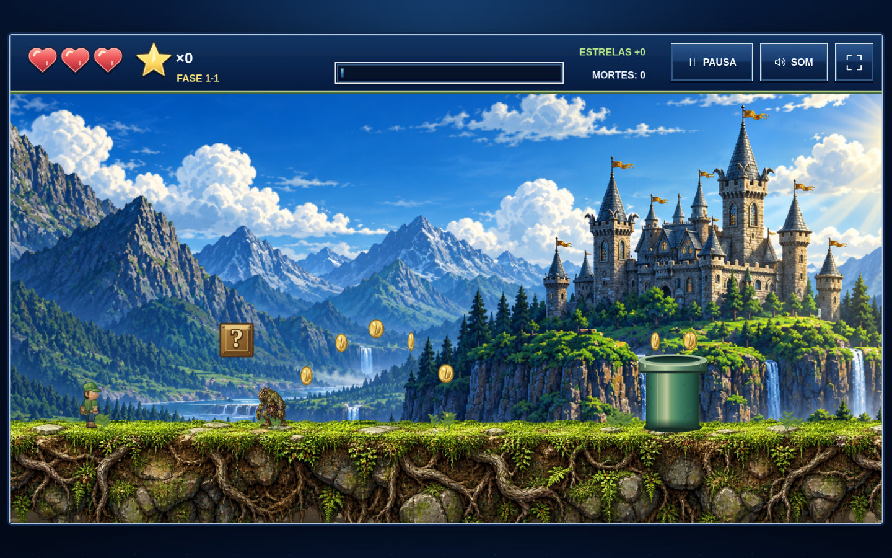

# Castle World V4 · O reino de Ruanda

Versão com visual de fantasia inspirado na referência enviada pelo usuário. As 14 etapas, guardiões, segredos, montarias e corrida bônus foram preservados.



## Jogar

Abra `index.html` em um navegador atualizado. Todas as imagens e o áudio estão incorporados: o jogo não precisa de conexão com a internet ou de WebGL.

Para desenvolver, também é possível servir esta pasta:

```sh
cd /workspace/Gamestest
python3 -m http.server 8000 --bind 127.0.0.1
```

O progresso e a preferência de som ficam salvos neste navegador. O salvamento pode não estar disponível em modo privado ou se o armazenamento local estiver bloqueado.

## Controles

| Ação | Teclado |
| --- | --- |
| Andar / direção na corrida | ← → ou A D |
| Pular / acelerar na corrida | Espaço, ↑ ou W |
| Entrar no cano / frear | ↓ ou S |
| Ação da montaria / nitro | X |
| Sair da montaria | C |
| Pausar / continuar | P ou Esc |
| Alternar som | M |
| Tela cheia | F |

No celular, use os botões de toque. É possível andar e pular simultaneamente. O modo horizontal oferece uma área de jogo maior; a orientação vertical também é permitida. No mapa, selecione uma etapa e use **Explorar fase**. A corrida é desbloqueada ao concluir a primeira etapa.

## Alterações

- Cenário ilustrado com castelo, montanhas, florestas e cachoeiras; variações de iluminação e clima.
- Terreno com arte de pedras, raízes, musgo e capim, blocos de bronze e canos metálicos.
- Herói e montarias com formas orgânicas, roupas sombreadas e animação articulada.
- Inimigos ilustrados: morcego, troll, serpente, xamã goblin e fera blindada, com pelagem, escamas, presas e placas naturais.
- Guardiões ilustrados e Drandaw como dragão de escamas escuras, asas e chifres.
- HUD azul de fantasia com corações vermelhos, estrela dourada, molduras prateadas e divisor verde, seguindo a referência.
- Menus, mapa, diálogos, poderes, corrida e controles combinando com o novo estilo.
- Entrada multitouch, teclas simultâneas e pausa ao perder o foco ou trocar de aba.
- Preferência de som persistente, validação de dados salvos e cache limitado de texturas para celular.

O código e as artes estão no próprio `index.html`. Não é necessário instalar pacotes ou executar um build. A renderização agora usa Canvas 2D e não depende de bibliotecas externas. As novas artes de cenário, terreno e criaturas foram geradas para esta versão; as animações e os elementos interativos são desenhados pelo jogo.
